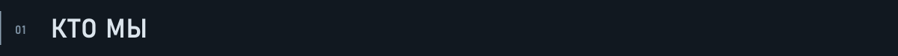
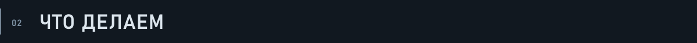
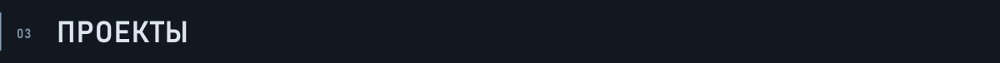
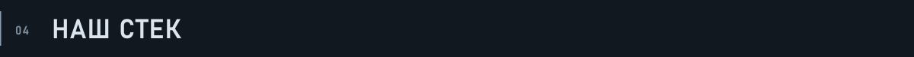
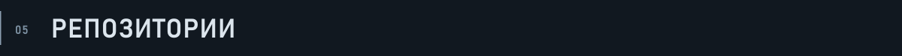

  
    
  <h1></h1>
  
Разработка ПО / игровой софт / автоматизация

  <code>C#</code> &nbsp; <code>C++</code> &nbsp; <code>Rust</code> &nbsp; <code>Python</code>

  <a href="#кто-мы">о нас</a> &nbsp; / &nbsp;
  <a href="#что-делаем">направления</a> &nbsp; / &nbsp;
  <a href="#проекты">проекты</a> &nbsp; / &nbsp;
  <a href="https://github.com/psichopodobny">psichopodobny ↗</a> &nbsp; / &nbsp;
  <a href="https://github.com/uikoll">uikole ↗</a>

<h2></h2>

**psichopodobny** и **uikole**. Нам по **16 лет**. Разрабатываем игровой софт, прикладные утилиты и инструменты автоматизации. Работаем на **C#**, **C++**, **Rust** и **Python**.

<table>
<tr>
<td width="50%" valign="top">

<h3></h3>

<code>DEVELOPMENT / REVERSE ENGINEERING</code>

Игровой софт для **Minecraft** и **Rust**, автоматизация, сайты и настройка серверов.

**Реверс-инжиниринг:** анализ бинарей и .NET-сборок, отладка, исследование памяти и логики программ.

**OSINT / GEOINT / HUMINT:** проверка открытой информации, работа с геопространственными материалами и человеческими источниками.

</td>
<td width="50%" valign="top">

<h3></h3>

<code>DEVELOPMENT / AUTOMATION</code>

Игровой софт и читы для **Minecraft** и **Rust**, прикладные утилиты и инструменты автоматизации.

**Сайты и серверы:** разработка, настройка окружения и запуск сервисов.

**OSINT / HUMINT:** поиск открытой информации, проверка источников и сопоставление сведений.

</td>
</tr>
</table>

 

<h2></h2>

<table>
<tr>
<td width="50%" valign="top">

<h3></h3>

Читы, клиентские инструменты и модификации для **Minecraft** и **Rust**.

<h3></h3>

Скрипты и приложения для обработки файлов, данных и повторяющихся операций.

</td>
<td width="50%" valign="top">

<h3></h3>

Разработка сайтов, настройка серверов и окружения, запуск сервисов.

<h3></h3>

**OSINT / HUMINT** - совместные направления. **Реверс-инжиниринг / GEOINT** - направления psichopodobny.

</td>
</tr>
</table>

 

<h2></h2>

Разработки **psichopodobny**. Для приватных репозиториев доступны краткие описания.

<table>
<tr>
<td width="50%" valign="top">

<h3></h3>

<code>PRIVATE</code>

Клиентский проект с закрытыми исходниками.

</td>
<td width="50%" valign="top">

<h3></h3>

<code>PRIVATE</code> &nbsp; <code>PWA / JavaScript</code>

Органайзер для учёбы: расписание, конспекты, формулы, учебники и заметки. Работает офлайн и устанавливается на Android как PWA.

</td>
</tr>
<tr>
<td width="50%" valign="top">

<h3></h3>

<code>PRIVATE</code> &nbsp; <code>Python / OSINT</code>

Инструменты для сбора и сопоставления информации, графового представления связей и подготовки отчётов по результатам исследований.

</td>
<td width="50%" valign="top">

<h3></h3>

<code>PUBLIC</code> &nbsp; <code>README / ARTWORK</code>

Общий README: направления работы, участники и ссылки на репозитории.

</td>
</tr>
<tr>
<td width="50%" valign="top">

<h3></h3>

<code>PRIVATE</code> &nbsp; <code>Rust</code>

Чит для Rust. Приватная разработка.

</td>
<td width="50%" valign="top">

<h3></h3>

<code>PRIVATE</code> &nbsp; <code>Majestic</code>

Утилита для скрытия от проверок на Majestic. Исходники закрыты.

</td>
</tr>
</table>

 

<h2></h2>

  
  
  
  

<code>Git</code> &nbsp; <code>GitHub</code> &nbsp; <code>VS Code</code> &nbsp; <code>Visual Studio</code>

 

  <h2></h2>
  <a href="https://github.com/psichopodobny?tab=repositories"><b>psichopodobny ↗</b></a>
  &nbsp; / &nbsp;
  <a href="https://github.com/uikoll?tab=repositories"><b>uikole ↗</b></a>

