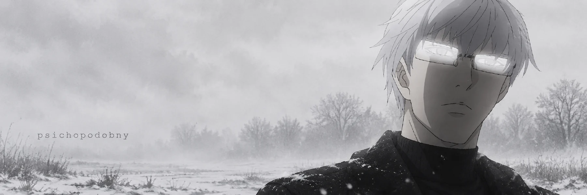
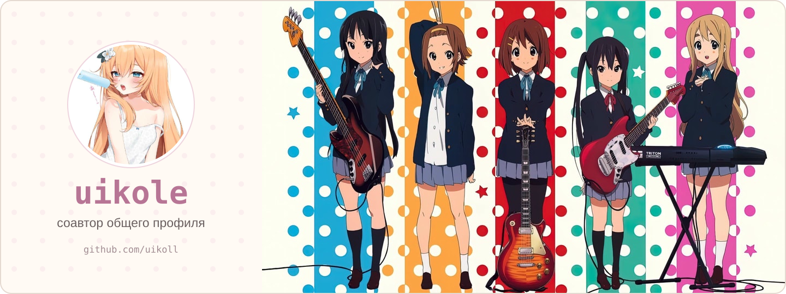

  

 

## обо мне

Мне 16, в сети я psichopodobny. Занимаюсь разработкой софта, реверсом и OSINT. Делаю читы, утилиты для автоматизации, сайты и инструменты под конкретные задачи. Ещё настраиваю серверы и сервисы.

Мне нравится разбираться в том, что происходит внутри программы: как устроена её логика, откуда берутся данные и как всё связано между собой. Из такого интереса часто вырастают идеи для собственных инструментов.

 

## чем занимаюсь

<table>
<tr>
<td width="50%" valign="top">

### читы и игровые инструменты

Разрабатываю читы и софт для работы с играми. Разбираюсь в игровых механиках и поведении программ, пробую разные подходы и собираю инструменты под нужную задачу.

### реверс-инжиниринг

Исследую устройство программ и их внутреннюю логику. Интересно понять, как работает конкретная функция, как взаимодействуют части приложения и почему оно ведёт себя именно так.

</td>
<td width="50%" valign="top">

### автоматизация и утилиты

Пишу софт, который берёт на себя повторяющиеся действия и экономит время. Это могут быть небольшие скрипты, обработка данных, работа с файлами или отдельная утилита с удобным интерфейсом.

### сайты и серверы

Делаю сайты и настраиваю серверы. Работаю с запуском сервисов, окружением и конфигурацией. Мне интересна и сама разработка, и то, как готовый проект будет работать после запуска.

</td>
</tr>
</table>

 

## OSINT

Занимаюсь поиском и проверкой информации. Стараюсь связывать отдельные находки между собой, понимать контекст и проверять, на чём основан вывод.

Мои основные направления:

- **GEOINT** - геопространственная информация, работа с картами, местностью и привязкой материалов к месту.
- **HUMINT** - информация от людей, оценка источников и контекста.

 

## партнёр

[uikoll](https://github.com/uikoll) - мой партнёр по разработке. Занимаемся похожими задачами: софт, автоматизация, игровые инструменты, реверс и исследования.

 

  <a href="https://github.com/psichopodobny?tab=repositories">мои проекты</a>
  &nbsp; / &nbsp;
  <a href="https://github.com/uikoll">профиль uikoll</a>

