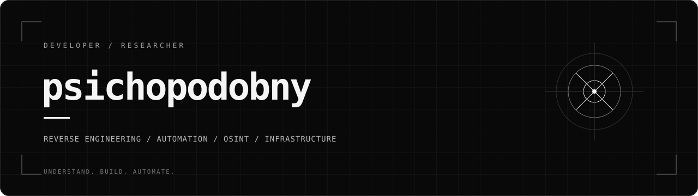

  

 

### о себе

Мне 16, я psichopodobny. Пишу читы и полезный софт, делаю сайты и настраиваю серверы. Занимаюсь реверсом - нравится разбираться, как работают программы, и делать свои инструменты.

Ещё занимаюсь OSINT, в основном GEOINT и HUMINT.

### чем занимаюсь

- читы и игровые инструменты
- автоматизация и утилиты для повседневных задач
- сайты и настройка серверов
- реверс-инжиниринг
- OSINT / GEOINT / HUMINT

 

### партнёр

[uikoll](https://github.com/uikoll) - мой партнёр по разработке.

 

[мои проекты](https://github.com/psichopodobny?tab=repositories)
