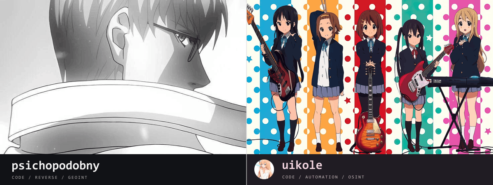
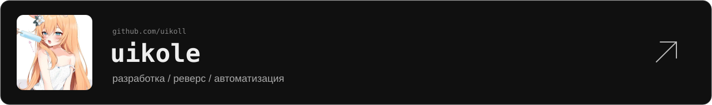

  
    
  <h1>psichopodobny and uikole</h1>
  
Два разработчика. Общие идеи, свои проекты и много кода.

  <code>C#</code> &nbsp; <code>C++</code> &nbsp; <code>Rust</code> &nbsp; <code>Python</code>

  <a href="#кто-мы">о нас</a> &nbsp; / &nbsp;
  <a href="#что-делаем">направления</a> &nbsp; / &nbsp;
  <a href="#проекты">проекты</a> &nbsp; / &nbsp;
  <a href="https://github.com/psichopodobny">psichopodobny ↗</a> &nbsp; / &nbsp;
  <a href="https://github.com/uikoll">uikole ↗</a>

## кто мы

Мы **psichopodobny** и **uikole**, нам обоим по **16 лет**. Занимаемся разработкой софта, игровыми инструментами, автоматизацией и исследованиями. Эта страница - место для наших общих направлений, идей и проектов.

<table>
<tr>
<td width="50%" valign="top">

### [psichopodobny](https://github.com/psichopodobny)

<code>16</code> &nbsp; <code>DEVELOPER / RESEARCHER</code>

Пишу на **C#**, **C++**, **Rust** и **Python**. Делаю читы для **Minecraft** и **Rust**, утилиты, софт для автоматизации, сайты и настраиваю серверы.

Мои отдельные направления - **реверс-инжиниринг**, разбор программ и **GEOINT**. Интересно понять, как работает софт, из чего складывается его поведение и как устроены данные внутри.

В исследованиях занимаюсь **OSINT**, проверкой открытой информации, геопространственными материалами и **HUMINT**. Сопоставляю источники и стараюсь разобраться в контексте находок.

</td>
<td width="50%" valign="top">

### [uikole](https://github.com/uikoll)

<code>16</code> &nbsp; <code>DEVELOPER / BUILDER</code>

Мой напарник по коду. Пишет на **C#**, **C++**, **Rust** и **Python**. Делает игровой софт, читы для **Minecraft** и **Rust**, полезные утилиты и инструменты для автоматизации.

Также занимается **сайтами**, **настройкой серверов**, **OSINT** и **HUMINT**. Ему интересны игровые модификации, технологии и идеи, которые можно превратить в собственный проект.

Ему близки музыка, игры и визуальный стиль **K-ON!**. Здесь он - вторая половина нашего дуо.

</td>
</tr>
</table>

У нас общий стек и много общих интересов. Вместе обсуждаем задачи, придумываем игровые инструменты и делаем софт, который упрощает повседневные действия. При этом у каждого есть собственные разработки и направления, в которые хочется копнуть глубже.

 

## что делаем

<table>
<tr>
<td width="50%" valign="top">

### игровой софт

Читы и игровые инструменты для **Minecraft** и **Rust**, небольшие утилиты и модификации под свои задачи. Интересны и сами игры, и разработка вокруг них.

### автоматизация

Скрипты и приложения для повторяющихся действий: обработка файлов и данных, удобные интерфейсы и инструменты, которые помогают меньше делать вручную.

</td>
<td width="50%" valign="top">

### сайты и серверы

Создаём сайты, настраиваем окружение и серверы, запускаем сервисы. Работаем над тем, чтобы проектом было удобно пользоваться после запуска.

### исследования

**OSINT и HUMINT** - общие интересы. Поиск открытой информации, проверка источников и сопоставление сведений. **Реверс и GEOINT** - отдельный фокус psichopodobny.

</td>
</tr>
</table>

 

## проекты

Несколько разработок **psichopodobny**. Для приватных проектов здесь только названия и короткие описания.

<table>
<tr>
<td width="50%" valign="top">

### Vortex-client

<code>PRIVATE</code>

Клиентский проект. Исходники и внутреннее устройство пока остаются закрытыми.

</td>
<td width="50%" valign="top">

### konspektik

<code>PRIVATE</code> &nbsp; <code>PWA / JavaScript</code>

Органайзер для учёбы: расписание, конспекты, формулы, учебники и заметки. Работает офлайн и устанавливается на Android как PWA.

</td>
</tr>
<tr>
<td width="50%" valign="top">

### Probivochka / Fusion OSINT

<code>PRIVATE</code> &nbsp; <code>Python / OSINT</code>

Инструменты для сбора и сопоставления информации, графового представления связей и подготовки отчётов по результатам исследований.

</td>
<td width="50%" valign="top">

### psichopodobny and uikole

<code>PUBLIC</code> &nbsp; <code>README / ARTWORK</code>

Эта общая страница: монохромная и цветная половины баннера, анимация и знакомство с тем, чем занимается каждый из нас.

</td>
</tr>
</table>

 

## наш стек

  
  
  
  

<code>Git</code> &nbsp; <code>GitHub</code> &nbsp; <code>VS Code</code> &nbsp; <code>Visual Studio</code>

 

## после кода

**Dota 2** / **VALORANT** / **Rust** / **GTA 5 RP - Majestic**

Иногда продолжаем обсуждать идеи уже в игре, иногда просто играем. По разработке и совместным проектам нас можно найти в профилях ниже.

  <h3>дальше - наши репозитории</h3>
  
Заглядывай в проекты и возвращайся за обновлениями.

  <a href="https://github.com/psichopodobny?tab=repositories"><b>psichopodobny ↗</b></a>
  &nbsp; / &nbsp;
  <a href="https://github.com/uikoll?tab=repositories"><b>uikole ↗</b></a>

